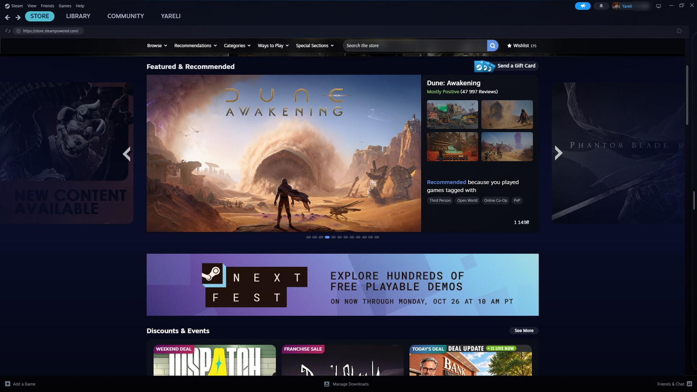
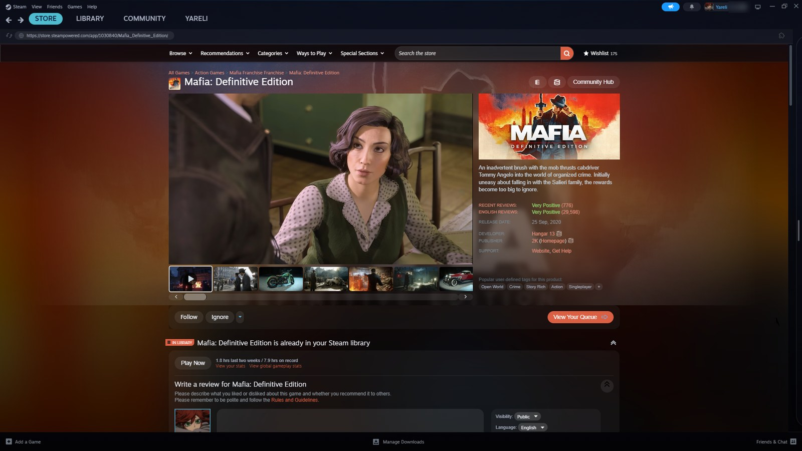
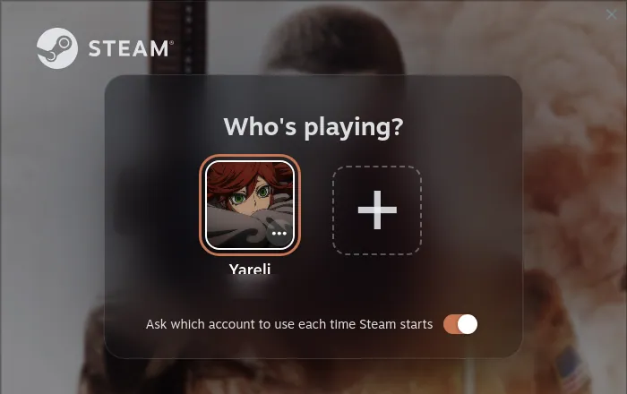

# Glass Dusk ES

Traducción al español de [Glass Dusk](https://github.com/Yareli0i/glass-dusk), el tema de Yareli para el cliente de escritorio de Steam con [Millennium](https://steambrew.app). Los paneles de cristal ahumado se superponen a la ilustración del juego abierto, y sus colores se usan en los botones y elementos destacados. Al abrir otro juego, cambia el color de todo el cliente.

Esta versión incluye los textos del tema y sus ajustes en español. El español está seleccionado de forma predeterminada; también están disponibles el inglés, el ucraniano y el francés para los textos del tema. Los textos propios de Steam siguen el idioma configurado en Steam.


Las capturas corresponden al tema original y muestran el cliente en inglés.

## Instalación

1. Instala Millennium si todavía no lo tienes.
2. Descarga y descomprime [este repositorio](https://github.com/Tomacods/glass-dusk-ES).
3. Coloca la carpeta del tema en `Steam/millennium/themes/glass-dusk-ES/`. El archivo debe quedar directamente en `Steam/millennium/themes/glass-dusk-ES/skin.json`, sin otra carpeta intermedia.
4. Abre Millennium → Themes, selecciona **Glass Dusk ES** y reinicia Steam para aplicar el tema.

Los nombres de los menús de Millennium pueden variar según su idioma. Para configurar el tema, abre Millennium → Themes → Glass Dusk ES → ⋯ → Settings.

El tema original indica pruebas en Windows 11 con el cliente de Steam 1788652215 y Millennium 3.5.0, y en Ubuntu 24.04 con la solución descrita más abajo. La traducción de este repositorio todavía requiere una comprobación visual dentro de Steam.

## Qué modifica

- **Biblioteca.** Dos paneles de cristal ahumado sobre la ilustración desenfocada del juego abierto, con la lista de juegos a la derecha. El inicio tiene su propio encabezado: saludo, estadísticas que puedes elegir, una tarjeta para continuar el último juego y juegos recientes.
- **Página del juego.** La ilustración ocupa todo el ancho, la barra de juego se presenta como una tarjeta y los enlaces de la página tienen forma de botones compactos.
- **Tienda.** Aplica el mismo cristal oscuro a la portada, las páginas de juegos, la búsqueda, las categorías, etiquetas y géneros, ofertas, demos, realidad virtual, menús, lista de deseados, carrito, estadísticas, calendario personal, recomendaciones, páginas de la cuenta, tienda de puntos y centro de noticias. Los precios, los bloques de *Añadir al carro*, las páginas de presentación y las ilustraciones de los eventos de ofertas conservan el aspecto de Steam.
- **Menús, ajustes, notificaciones, amigos y chat.** Comparten el color de la ventana principal.
- **Inicio de sesión.** El selector de cuenta y la pantalla de acceso pueden mostrar la ilustración del último juego, las portadas de tus juegos en movimiento o una presentación de sus ilustraciones. El selector aparece sobre una tarjeta de cristal. Steam solo muestra estas pantallas cuando está configurado para preguntar qué cuenta usar.
- **Complementos.** HLTB for Steam, Achievement Groups, Player Count y Extendium adoptan los colores del tema. Size on Disk, Non-Steam Playtimes y Easy SteamGrid ya usan componentes compatibles. Las extensiones instaladas mediante Extendium, como SteamDB y Augmented Steam, presentan sus bloques de la tienda con tarjetas del mismo estilo.
- **Comunidad y perfiles.** Conservan el aspecto de Steam y los fondos y temas elegidos por cada usuario.
- **Big Picture.** La ilustración del juego seleccionado llena la pantalla de inicio y aporta el color de las pestañas y los indicadores de selección. Una etiqueta arriba a la izquierda muestra las horas jugadas y la última partida.
- **Interfaz superpuesta del juego (Mayús+Tab).** Un velo ligero sustituye el fondo casi negro de Steam para mantener visible el juego. La vista general y la barra de herramientas usan cristal ahumado con los colores del juego en ejecución.







## Ajustes

Los cambios se aplican después de reiniciar Steam. Los valores en **negrita** son los predeterminados. En la tabla, activado y desactivado describen la posición de los interruptores.

| Ajuste | Valores | Función |
|---|---|---|
| Idioma del tema | **Español** · English · Українська · Français | Idioma del encabezado de inicio, la etiqueta de Big Picture y las fechas. El idioma propio de Steam se configura por separado. |
| Fondo | **Ilustración del juego** · Pradera · Atardecer liso | Imagen o color que aparece detrás del cristal. |
| Ilustración de fondo | **Normal** · Suave · Intensa | Intensidad con la que se ve la ilustración del juego. |
| Color de acento | **Ilustración del juego** · Fijo | *Fijo* mantiene en todo el cliente el color de acento elegido en la pestaña de colores. |
| Cristal | **Normal** · Más opaco · Más transparente | Transparencia de los paneles. |
| Esquinas | **Normal** · Más redondeadas · Más rectas | Curvatura de paneles y tarjetas. |
| Inicio de sesión | **Ilustración del juego** · Tus juegos · Presentación · Atardecer · Muro de Steam · Steam | Fondo y aspecto del selector de cuenta y la pantalla de acceso. Solo aparecen cuando Steam pregunta qué cuenta usar. |
| Inicio de la biblioteca | **Tema** · Steam | Encabezado del tema con saludo, estadísticas y tarjeta *Continuar*, o solo las secciones de Steam. |
| Estadística: Juegos; Horas jugadas; Espacio en disco | **Activada** · Desactivada | Tres cifras del encabezado, cada una con su propio interruptor. |
| Estadística: Horas en 2 semanas; Sin jugar; Juegos perfectos | Activada · **Desactivada** | Otras tres cifras. Los juegos perfectos tienen todos sus logros desbloqueados. |
| Estadísticas: segunda línea | Activada · **Desactivada** | Información bajo cada cifra: juegos instalados o jugados, porcentaje de la biblioteca, progreso medio y unidades de almacenamiento. |
| Sección de juegos recientes | **Activada** · Desactivada | Fila de juegos recientes debajo de la tarjeta *Continuar*. |
| Juegos recientes: vista previa | **Activada** · Desactivada | Al pasar el cursor sobre una portada, muestra capturas, el nombre del juego y las horas jugadas. Las capturas se descargan de Steam en ese momento. |
| Juegos del inicio | **Instalados** · Toda la biblioteca | De dónde salen los juegos de la tarjeta *Continuar* y de la sección de recientes. Los juegos sin instalar muestran *Instalar* en lugar de *Jugar*. |
| Tarjeta Continuar: logros | Activados · **Desactivados** | Progreso de logros del juego de la tarjeta *Continuar*. |
| Sección de novedades | Activada · **Desactivada** | Sección de novedades de Steam en el inicio de la biblioteca. |
| Botón Añadir sección | **Activado** · Desactivado | Fila de Steam para añadir una sección al inicio. |
| Posición de la lista de juegos | **Derecha** · Izquierda | Ubicación de la lista de juegos. |
| Tienda: lista de juegos | **Desactivada** · Fija · Al pasar el cursor · Barra de portadas | Lista de juegos junto a la tienda y otras páginas web del cliente. Puede quedar fija, abrirse al señalar el borde o mostrarse como una barra de portadas recientes con un botón para abrir la lista completa. Conserva las colecciones, la búsqueda y los filtros de Steam. |
| Página del juego: etiquetas de colecciones | **Activadas** · Desactivadas | Colecciones a las que pertenece el juego, arriba a la derecha de la ilustración. Al pulsarlas se abre la colección. |
| Big Picture | **Ilustración** · Steam | Ilustración del juego seleccionado a pantalla completa o aspecto habitual de Big Picture. |
| Información de juego en Big Picture | **Activada** · Desactivada | Logotipo, horas jugadas y última partida arriba a la izquierda. |
| Fondo de la superposición | **Transparente** · Steam | Fondo detrás de los paneles de Mayús+Tab. |
| Paneles de la superposición | **Cristal** · Steam | Aspecto de la vista general, el navegador y la barra de herramientas. |
| Complementos | **Tema** · Propios del complemento | Colores del tema o aspecto original de los complementos que tienen su propia interfaz. |

La pestaña **Colors** de Millennium permite configurar seis colores: acento, texto, texto secundario, tinte del cristal, barra de juego y fondo de la tienda.

### Linux

El tema original documenta un problema por el que la lista de juegos se mueve a la derecha, pero la barra superior, la biblioteca y las páginas de juegos mantienen el aspecto habitual de Steam. Esto indica que no se ha cargado el enlace de Millennium con el proceso web de Steam. El tema usa nombres de clases legibles que Millennium restaura a partir de la versión 3.4.0. Según esa documentación, en Linux el instalador crea enlaces desde `/usr/lib/millennium` que el proceso web de Steam no puede ver dentro de su contenedor.

La solución documentada por el autor consiste en cerrar Steam y sustituir esos dos enlaces por copias:

```bash
cd ~/.steam/steam/ubuntu12_64
rm -f libXtst.so.6 libmillennium_hhx64.so
cp /usr/lib/millennium/libmillennium_bootstrap_hhx64.so libXtst.so.6
cp /usr/lib/millennium/libmillennium_hhx64.so libmillennium_hhx64.so
```

Después, inicia Steam de nuevo. El autor indica repetir el procedimiento tras cada actualización de Millennium. Se aplica a una instalación normal de Steam con Millennium instalado mediante su script o AUR; `ubuntu12_64` es el nombre de la carpeta de Steam en todas las distribuciones. NixOS guarda estos archivos en otro lugar. La documentación original no contempla Steam instalado mediante Flatpak o Snap.

## Detalles y limitaciones

- La interfaz superpuesta no puede desenfocar el juego que queda detrás de sus paneles: Steam compone el juego fuera de la página. Por eso utiliza un tinte de cristal más opaco.
- Las ilustraciones personalizadas muy grandes pueden ralentizar Big Picture, también sin este tema. Las portadas PNG animadas de SteamGridDB pueden ocupar decenas de megabytes; si aparecen tirones al mostrarlas, prueba una versión más ligera.
- La etiqueta de Big Picture es informativa y no se puede seleccionar con el mando.
- *Juegos perfectos* cuenta los juegos con todos los logros desbloqueados. Steam no registra si has terminado la historia. Cuando esta estadística está activada, el tema solicita actualizar los datos de logros de los juegos utilizados desde la última consulta y de cada juego jugado una vez al día.
- Los ajustes del tema se muestran en español en este fork. El selector de idioma cambia los textos generados por el tema, no las etiquetas de sus ajustes ni los textos de Steam o de otros complementos.

## Soporte y créditos

El tema original es gratuito. Puedes apoyar a su autor, Yareli, en [Ko-fi](https://ko-fi.com/yareli0i).

- Traducción y adaptación al español: [Tomacods/glass-dusk-ES](https://github.com/Tomacods/glass-dusk-ES). Los problemas de traducción se pueden informar en los [Issues de este repositorio](https://github.com/Tomacods/glass-dusk-ES/issues).
- Tema original y diseño: [Yareli0i/glass-dusk](https://github.com/Yareli0i/glass-dusk). Sus [Issues](https://github.com/Yareli0i/glass-dusk/issues) recogen problemas y propuestas del tema original.
- Código: [licencia MIT](LICENSE).
- Fuente de las cifras: JetBrains Mono ExtraBold, [SIL OFL 1.1](assets/OFL-JetBrainsMono.txt).
- Fondo de pradera: creado por el autor original.
- Traducción al francés: [Warzox](https://github.com/ImWarzox).
- Las ilustraciones de los juegos proceden de tu biblioteca de Steam y pertenecen a sus titulares.

Cambios de esta traducción e historial original: [CHANGELOG.md](CHANGELOG.md). Documentación técnica del tema original, en inglés: [DEVELOPMENT.md](DEVELOPMENT.md).
