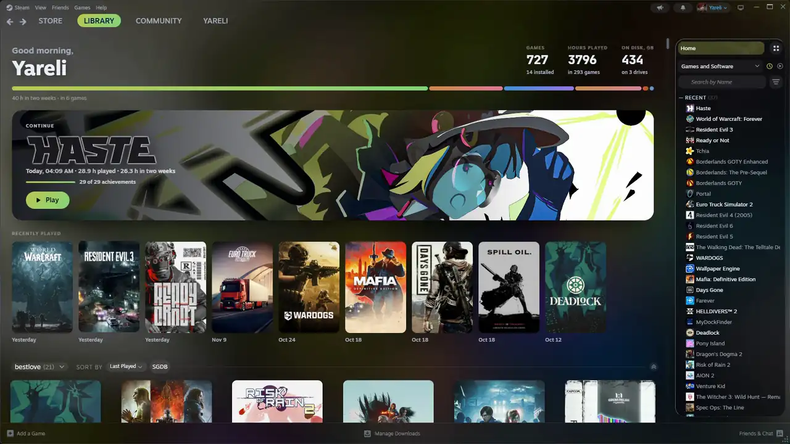
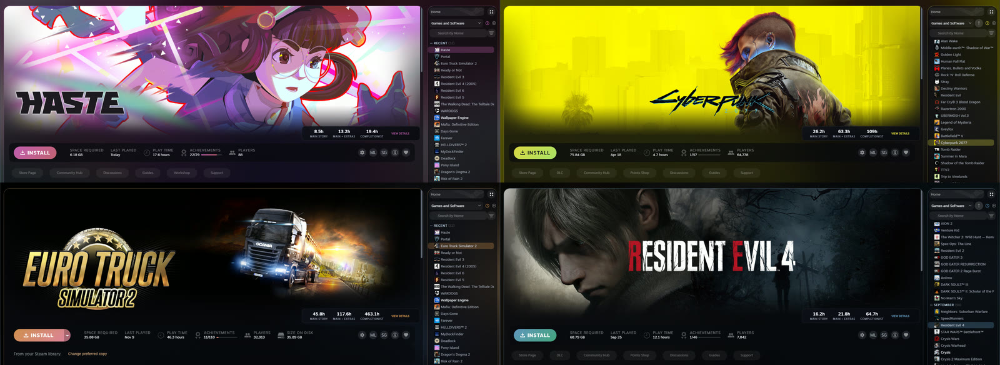
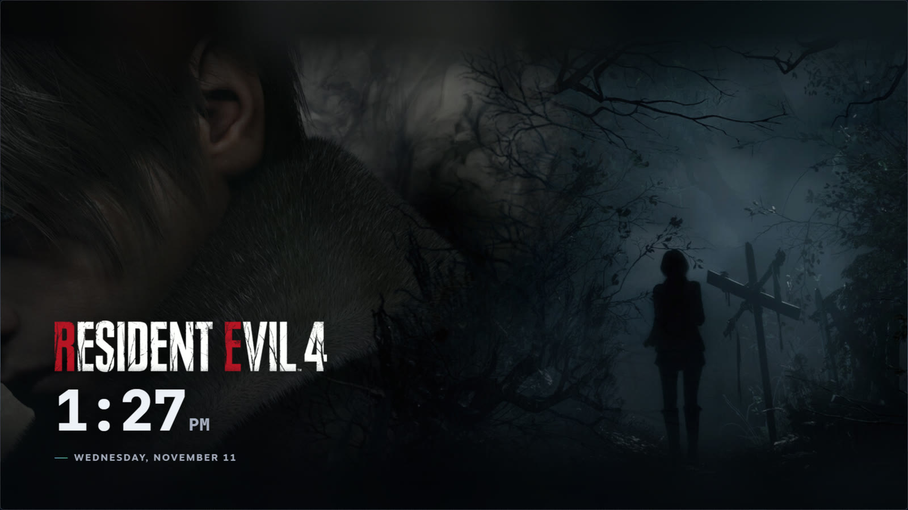
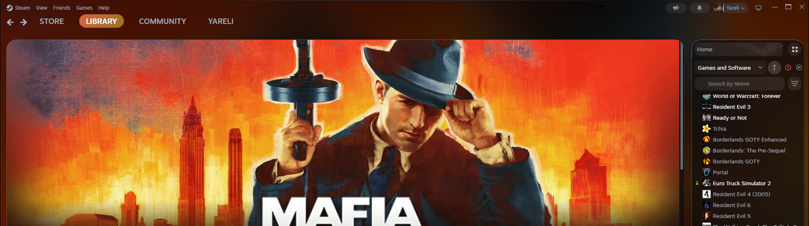
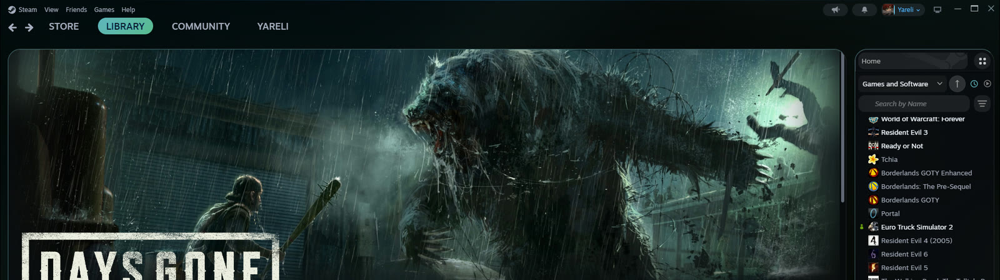
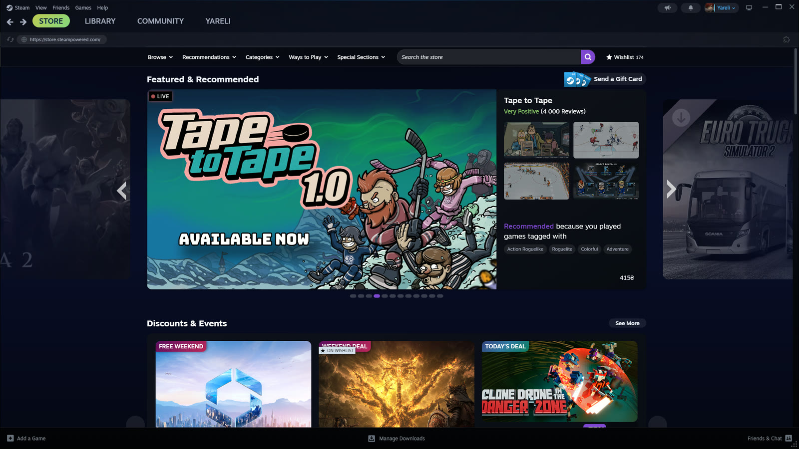
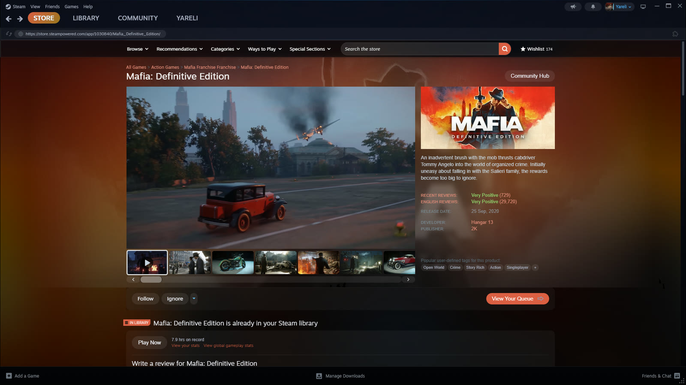
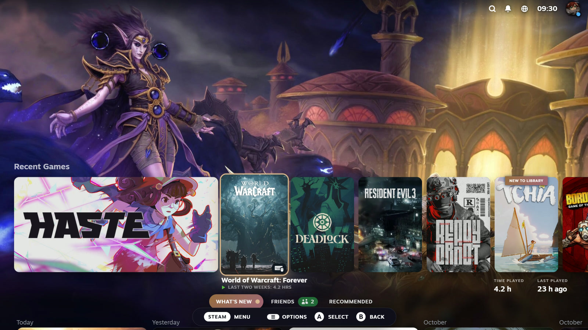
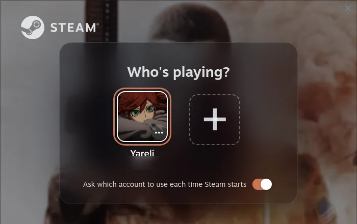

# Glass Dusk ES

Traducción al español de [Glass Dusk](https://github.com/Yareli0i/glass-dusk), el tema de Yareli para el cliente de escritorio de Steam con [Millennium](https://steambrew.app). Los paneles de cristal ahumado se superponen a la ilustración del juego abierto, y sus colores se usan en los botones y elementos destacados. Al abrir otro juego, cambia el color de todo el cliente.

Esta versión incluye los textos del tema y sus ajustes en español. El español está seleccionado de forma predeterminada; también están disponibles el inglés, el ucraniano y el francés para los textos del tema. Los textos propios de Steam siguen el idioma configurado en Steam.



Las capturas corresponden al tema original y muestran el cliente en inglés.

## Instalación

1. Instala Millennium si todavía no lo tienes.
2. Descarga y descomprime [este repositorio](https://github.com/Tomacods/glass-dusk-ES).
3. Coloca la carpeta del tema en `Steam/millennium/themes/glass-dusk-ES/`. El archivo debe quedar directamente en `Steam/millennium/themes/glass-dusk-ES/skin.json`, sin otra carpeta intermedia.
4. Abre Millennium → Themes, selecciona **Glass Dusk ES** y reinicia Steam para aplicar el tema.

Los nombres de los menús de Millennium pueden variar según su idioma. Para configurar el tema, abre Millennium → Themes → Glass Dusk ES → ⋯ → Settings.

El catálogo de steambrew.app instala el tema original, en inglés; esta traducción se instala a mano como se indica arriba.

El tema original indica pruebas en Windows 11 con el cliente de Steam 1794424036 y Millennium 3.6.2, y en Ubuntu 24.04 con la solución descrita más abajo. La traducción de este repositorio todavía requiere una comprobación visual dentro de Steam.

## Qué modifica

- **Biblioteca.** Dos paneles de cristal ahumado sobre la ilustración desenfocada del juego abierto, con la lista de juegos a la derecha. El cristal tiene un grano fino y sus bordes toman el color del juego. El inicio tiene su propio encabezado: saludo, estadísticas que puedes elegir, una tarjeta para continuar el último juego y juegos recientes.
- **Color.** Cada juego aporta al cliente dos colores de su ilustración, cercanos entre sí e igual de luminosos. Los botones y las barras pasan de uno a otro y, al abrir otro juego, el color cambia gradualmente al nuevo. Cada juego conserva sus colores: la fila bajo el puntero en la lista de juegos usa los de su juego, y el inicio muestra tus dos últimas semanas en una barra con los colores de lo que jugaste.
- **Modo en reposo.** Si dejas la biblioteca sin tocar, Steam muestra la ilustración del juego en pantalla con su logotipo, la hora y la fecha. Al mover el puntero, el cliente vuelve.
- **Página del juego.** La ilustración ocupa todo el ancho, la barra de juego se presenta como una tarjeta y los enlaces de la página tienen forma de botones compactos.
- **Tienda.** Aplica el mismo cristal oscuro a la portada, las páginas de juegos, la búsqueda, las categorías, etiquetas y géneros, ofertas, demos, realidad virtual, menús, lista de deseados, carrito, estadísticas, calendario personal, recomendaciones, páginas de la cuenta, tienda de puntos y centro de noticias. Los precios, los bloques de *Añadir al carro*, las páginas de presentación y las ilustraciones de los eventos de ofertas conservan el aspecto de Steam.
- **Menús, ajustes y notificaciones.** Comparten el color de la ventana principal.
- **Amigos y chat.** El estado conserva los colores de Steam y se convierte en un anillo alrededor de cada avatar; los amigos que están jugando brillan en verde; los grupos, las conversaciones, los canales y el campo de escritura usan cristal y color de acento.
- **Inicio de sesión.** El selector de cuenta y la pantalla de acceso pueden mostrar la ilustración del último juego, las portadas de tus juegos en movimiento o una presentación de sus ilustraciones. El selector aparece sobre una tarjeta de cristal. Steam solo muestra estas pantallas cuando está configurado para preguntar qué cuenta usar.
- **Complementos.** HLTB for Steam, Achievement Groups, Player Count, Extendium y Command Palette adoptan los colores del tema. Size on Disk, Non-Steam Playtimes y Easy SteamGrid ya usan componentes compatibles. Las extensiones instaladas mediante Extendium, como SteamDB y Augmented Steam, presentan sus bloques de la tienda con tarjetas del mismo estilo.
- **Comunidad y perfiles.** Conservan el aspecto de Steam y los fondos y temas elegidos por cada usuario.
- **Big Picture.** La ilustración del juego seleccionado llena el inicio, nítida, con el carrusel al pie, y aporta sus dos colores a las pestañas, los botones y el anillo alrededor del elemento seleccionado con el mando. Bajo el carrusel aparecen los datos del juego: tiempo de juego, última sesión y logros. En las demás pantallas la ilustración queda más al fondo; la página del juego, la biblioteca, los ajustes, el menú de Steam y el menú de acceso rápido son de cristal ahumado sobre ella.
- **Interfaz superpuesta del juego (Mayús+Tab).** Un velo ligero sustituye el fondo casi negro de Steam para mantener visible el juego. La vista general y la barra de herramientas usan cristal ahumado con los colores del juego en ejecución.










## Ajustes

Los cambios se aplican después de reiniciar Steam. Los valores en **negrita** son los predeterminados. En la tabla, activado y desactivado describen la posición de los interruptores.

| Ajuste | Valores | Función |
|---|---|---|
| Saldo de la cartera | **Mostrar** · Desenfocar hasta pasar el puntero | El saldo de la barra superior. Desenfocado, se muestra al pasar el puntero por encima. |
| Idioma del tema | **Español** · English · Українська · Français | Idioma del encabezado de inicio, la información de juego en Big Picture y las fechas. El idioma propio de Steam se configura por separado. |
| Fondo | **Ilustración del juego** · Pradera · Atardecer liso | Imagen o color que aparece detrás del cristal. |
| Ilustración de fondo | **Normal** · Suave · Intensa | Intensidad con la que se ve la ilustración del juego. |
| Color de acento | **Ilustración del juego** · Fijo | *Ilustración del juego*: los colores del juego en pantalla y, si no hay ninguno (tienda, comunidad, descargas), los del último. *Fijo* mantiene en todo el cliente el color de acento elegido en la pestaña de colores. |
| Estilo del acento | **Bicolor** · Sólido | *Bicolor* toma un segundo color de la ilustración del juego, cercano al primero e igual de luminoso, y lleva los botones principales y las barras de progreso de uno a otro. *Sólido* usa un solo color. |
| Cristal | **Normal** · Más opaco · Más transparente | Transparencia de los paneles. |
| Acabado del cristal | **Grano y borde iluminado** · Grano · Borde iluminado · Liso | Superficie de los paneles de cristal: un grano fino y los bordes que miran a la luz iluminados con el color de acento. *Liso* es un cristal suave con un borde fino uniforme. |
| Esquinas | **Normal** · Más redondeadas · Más rectas | Curvatura de paneles y tarjetas. |
| Transiciones | **Graduales** · Instantáneas | Al abrir otro juego, el color de acento pasa gradualmente del anterior al nuevo y la ilustración detrás del cristal se funde con la siguiente, o ambas cambian de golpe. La opción del sistema para reducir el movimiento también las vuelve instantáneas. |
| Inicio de sesión | **Ilustración del juego** · Tus juegos · Presentación · Atardecer · Muro de Steam · Steam | Fondo y aspecto del selector de cuenta y la pantalla de acceso. Solo aparecen cuando Steam pregunta qué cuenta usar. |
| En reposo | **A los 5 minutos** · A los 2 minutos · A los 15 minutos · Nunca | Si dejas la biblioteca sin tocar, Steam muestra la ilustración del juego en pantalla con su logotipo, la hora y la fecha; el primer movimiento lo devuelve todo. No ocurre mientras se descarga algo o se reproduce un video, ni sobre la tienda. |
| Inicio de la biblioteca | **Tema** · Steam | Encabezado del tema con saludo, estadísticas y tarjeta *Continuar*, o solo las secciones de Steam. |
| Estadística: Juegos; Horas jugadas; Espacio en disco | **Activada** · Desactivada | Tres cifras del encabezado, cada una con su propio interruptor. |
| Estadística: Horas en 2 semanas; Sin jugar; Juegos perfectos | Activada · **Desactivada** | Otras tres cifras. Los juegos perfectos tienen todos sus logros desbloqueados. |
| Estadísticas: segunda línea | Activada · **Desactivada** | Información bajo cada cifra: juegos instalados o jugados, porcentaje de la biblioteca, progreso medio y unidades de almacenamiento. |
| Inicio: dos semanas en color | **Activada** · Desactivada | Una barra bajo el saludo con cada juego jugado en las últimas dos semanas, tan ancho como su parte de las horas y con sus propios colores. Pasa el puntero por una parte para ver el juego y sus horas; un clic lo abre. |
| Sección de juegos recientes | **Activada** · Desactivada | Fila de juegos recientes debajo de la tarjeta *Continuar*. |
| Juegos recientes: vista previa | **Activada** · Desactivada | Al pasar el cursor sobre una portada, muestra capturas, el nombre del juego y las horas jugadas. Las capturas se descargan de Steam en ese momento. |
| Juegos del inicio | **Instalados** · Toda la biblioteca | De dónde salen los juegos de la tarjeta *Continuar* y de la sección de recientes. Los juegos sin instalar muestran *Instalar* en lugar de *Jugar*. |
| Tarjeta Continuar: logros | Activados · **Desactivados** | Progreso de logros del juego de la tarjeta *Continuar*. |
| Sección de novedades | Activada · **Desactivada** | Sección de novedades de Steam en el inicio de la biblioteca. |
| Botón Añadir sección | **Activado** · Desactivado | Fila de Steam para añadir una sección al inicio. |
| Posición de la lista de juegos | **Derecha** · Izquierda | Ubicación de la lista de juegos. |
| Tienda: lista de juegos | **Desactivada** · Fija · Al pasar el cursor · Barra de portadas | Lista de juegos junto a la tienda y otras páginas web del cliente. Puede quedar fija, abrirse al señalar el borde o mostrarse como una barra de portadas recientes con un botón para abrir la lista completa. Conserva las colecciones, la búsqueda y los filtros de Steam. |
| Página del juego: etiquetas de colecciones | **Activadas** · Desactivadas | Colecciones a las que pertenece el juego, arriba a la derecha de la ilustración. Al pulsarlas se abre la colección. |
| Big Picture | **Ilustración** · Steam | Ilustración del juego seleccionado a pantalla completa o aspecto habitual de Big Picture. |
| Inicio de Big Picture | **Ilustración grande** · De Steam | *Ilustración grande*: la ilustración nítida en toda la primera pantalla con el carrusel al pie, como en el modo Big Art de Steam, esté o no activado ese ajuste de Steam. *De Steam* deja la disposición a ese ajuste. |
| Información de juego en Big Picture | **Activada** · Desactivada | Los datos del juego seleccionado bajo el carrusel: tiempo de juego, última sesión y logros. |
| Fondo de la superposición | **Transparente** · Steam | Fondo detrás de los paneles de Mayús+Tab. |
| Paneles de la superposición | **Cristal** · Steam | Aspecto de la vista general, el navegador y la barra de herramientas. |
| Complementos | **Tema** · Propios del complemento | Colores del tema o aspecto original de los complementos que tienen su propia interfaz. |

La pestaña **Colors** de Millennium permite configurar seis colores: acento, texto, texto secundario, tinte del cristal, barra de juego y fondo de la tienda.

### Linux

El tema original documenta un problema por el que la lista de juegos se mueve a la derecha, pero la barra superior, la biblioteca y las páginas de juegos mantienen el aspecto habitual de Steam. Esto indica que no se ha cargado el enlace de Millennium con el proceso web de Steam. El tema usa nombres de clases legibles que Millennium restaura a partir de la versión 3.4.0. Según esa documentación, en Linux el instalador crea enlaces desde `/usr/lib/millennium` que el proceso web de Steam no puede ver dentro de su contenedor.

La solución documentada por el autor consiste en cerrar Steam y sustituir esos dos enlaces por copias:

```bash
cd ~/.steam/steam/ubuntu12_64
rm -f libXtst.so.6 libmillennium_hhx64.so
cp /usr/lib/millennium/libmillennium_bootstrap_hhx64.so libXtst.so.6
cp /usr/lib/millennium/libmillennium_hhx64.so libmillennium_hhx64.so
```

Después, inicia Steam de nuevo. El autor indica repetir el procedimiento tras cada actualización de Millennium. Se aplica a una instalación normal de Steam con Millennium instalado mediante su script o AUR; `ubuntu12_64` es el nombre de la carpeta de Steam en todas las distribuciones. NixOS guarda estos archivos en otro lugar. La documentación original no contempla Steam instalado mediante Flatpak o Snap.

### La tienda tiene el tema y la biblioteca no

Si la tienda se ve bien pero la ventana principal mantiene el aspecto habitual de Steam (sin cristal, con la lista de juegos a la izquierda y el inicio propio de Steam), no se cargaron los nombres de clase legibles de Steam. El tema está escrito sobre ellos, y Millennium (3.4.0 y posteriores) los añade a los scripts de Steam al iniciarse el cliente. La tienda es una página web con nombres de clase propios, por eso es lo único que sigue viéndose bien. Desde la versión 2.0.2, la ventana principal lo avisa con una línea en su barra inferior; si la biblioteca tiene el aspecto habitual y esa línea no aparece, la causa es otra y conviene informarla.

- Cierra Steam por completo (Steam → Salir; no basta con cerrar la ventana) y vuelve a abrirlo. Después, en Millennium, cambia a otro tema y vuelve a Glass Dusk ES. Esto lo ha resuelto en otras ocasiones.
- En Linux, consulta la sección anterior.
- Si persiste, la causa está entre Millennium y esa instalación de Steam, no en el tema: otros temas escritos sobre los nombres legibles mostrarán lo mismo, mientras que los escritos sobre los nombres cifrados de Steam no. Puedes consultarlo en el [registro de problemas de Millennium](https://github.com/SteamClientHomebrew/Millennium/issues) o en su Discord.

## Detalles y limitaciones

- La interfaz superpuesta no puede desenfocar el juego que queda detrás de sus paneles: Steam compone el juego fuera de la página. Por eso utiliza un tinte de cristal más opaco.
- Las ilustraciones personalizadas muy grandes pueden ralentizar Big Picture, también sin este tema. Las portadas PNG animadas de SteamGridDB pueden ocupar decenas de megabytes; si aparecen tirones al mostrarlas, prueba una versión más ligera.
- Los datos bajo el carrusel de Big Picture son informativos y no se pueden seleccionar con el mando.
- *Juegos perfectos* cuenta los juegos con todos los logros desbloqueados. Steam no registra si has terminado la historia. Cuando esta estadística está activada, el tema solicita actualizar los datos de logros de los juegos utilizados desde la última consulta y de cada juego jugado una vez al día.
- Big Picture tiene su propio salvapantallas (Configuración → Personalización). En [extras/screensaver](extras/screensaver/README.md) hay uno de Glass Dusk, con el atardecer del tema, la hora y la fecha. Es opcional, experimental y se instala a mano: el tema nunca escribe en la carpeta de Steam, y la página no se ha probado dentro de Steam. Sus instrucciones están en inglés.
- El menú de Steam y el menú de acceso rápido de Big Picture reciben el estilo desde la ventana de Big Picture, porque Millennium no carga temas en ellos. Si una actualización de Steam los cambia, vuelven al aspecto de Steam hasta que el tema se actualice; no afecta a nada más.
- Los ajustes del tema se muestran en español en este fork. El selector de idioma cambia los textos generados por el tema, no las etiquetas de sus ajustes ni los textos de Steam o de otros complementos.

## Soporte y créditos

El tema original es gratuito. Puedes apoyar a su autor, Yareli, en [Ko-fi](https://ko-fi.com/yareli0i).

- Traducción y adaptación al español: [Tomacods/glass-dusk-ES](https://github.com/Tomacods/glass-dusk-ES). Los problemas de traducción se pueden informar en los [Issues de este repositorio](https://github.com/Tomacods/glass-dusk-ES/issues).
- Tema original y diseño: [Yareli0i/glass-dusk](https://github.com/Yareli0i/glass-dusk). Sus [Issues](https://github.com/Yareli0i/glass-dusk/issues) recogen problemas y propuestas del tema original.
- Código: [licencia MIT](LICENSE).
- Fuente de las cifras: JetBrains Mono ExtraBold, [SIL OFL 1.1](assets/OFL-JetBrainsMono.txt).
- Fondo de pradera: creado por el autor original.
- Traducción al francés: [Warzox](https://github.com/ImWarzox).
- Las ilustraciones de los juegos proceden de tu biblioteca de Steam y pertenecen a sus titulares.

Cambios de esta traducción e historial original: [CHANGELOG.md](CHANGELOG.md). Documentación técnica del tema original, en inglés: [DEVELOPMENT.md](DEVELOPMENT.md).
